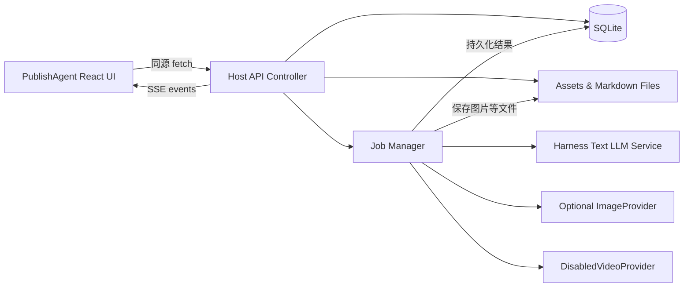

# PublishAgent for DeepSeek Harness — 原生插件高保真复刻技术方案

> 文档版本：v1.0 · 2026-11-15  
> 目标：把提供的 PublishAgent 截图复刻为 DeepSeek Harness **可安装的原生插件**。不开发注册登录，不另起独立站点，不依赖 MySQL / Redis / GoFrame。先完成全套 UI 和核心文字创作；图片生成实现可扩展适配器，有可用提供商时启用；**视频生成仅做 UI 占位，不接模型、不扣费、不创建真实生成任务**。  
> 输入视觉参考：`assets/ui-reference.png`（1280 × 774，原始截图）。  
> 实现语言：TypeScript + React（Browser Client）/ Node.js（Harness Host）；存储 SQLite + 文件系统。

---

## 0. 给 AI 编程助手的首要指令（必须先读）

**最终交付物是能被 DeepSeek Harness 安装、打开、卸载的插件，不是独立 Vue 网页、HTML 效果图，也不是修改过的 Harness 源码。**

1. 请先阅读此 Markdown、原始参考图和宿主当前版本的官方插件文档，再检查本机安装的 Harness 版本及真实 API，**不要自行发明 `ctx` 方法或沿用过时的 slot**。
2. 先做最小可安装插件：能出现在 Harness 左侧导航（`sidebar.panellist`），点击显示独立工作台（`main` keyed slot），退出插件恢复原有页面。
3. 在这个真实入口内实现完整的 PublishAgent 界面。所有页面、模态框、抽屉、弹出菜单及状态必须可交互。禁止把截图整体当作背景图片蒙在页面上冒充复刻。
4. **优先 UI 高保真**：截图中真实存在的布局、留白、圆角、花瓣背景、暖金色按钮、棕黑面板和中文排版均按文档实现。截图涉及的人像/风景作为**素材参考**，使用合法授权或原创素材重建；不得直接把整张截图切成伪 UI。
5. 核心业务：文章生成、标题生成、模板选用、草稿、素材、创作记录、搜索、设置、导出。文字生成优先复用 Harness 已配置 LLM；图片生成走可选 Provider；视频页只占位。
6. 未配置模型时，UI 仍完整可用；真实生成按钮应明确报「请配置模型」，**不能用随机文案冒充 AI 输出**。可以提供显式的 Demo 演示开关供 UI 验收。
7. 不做用户账号、付费会员、套餐、支付、管理后台、多租户。截图中的「尊享会员」改为非付费的「模型与设置」，保留相近排版外观。
8. 先完成一个阶段并执行测试，再进入下一阶段；所有宿主适配代码放在 `adapters/harness/`，不得到处引用私有 API。

### 验收优先顺序

`插件安装成功 > 入口和主面板可用 > UI 高保真 > 页面交互 > 本地存储 > 文字模型真实调用 > 图片模型可选调用 > 完整导出 > 发布包`

---

## 1. 边界、目标与不做的事

### 1.1 产品定位

PublishAgent 是一个**本地优先的 AI 内容创作工作台**，嵌入 DeepSeek Harness：

- 首页：创作入口、灵感卡、热门功能、精选模板、最近创作。
- AI 创作：文章、营销文案、小红书笔记、爆款标题、图片、视频占位。
- 素材库：图片、文字、提示词、文件的本地保存、分类和预览。
- 创作记录：搜索、查看、续写、重新生成、导出、归档、删除。
- 发布管理：第一版为**导出/复制/待发布列表**，不自动调用微信、小红书、抖音发布接口。
- 灵感中心：内置灵感池，随机切换/一键生成同主题创作表单。
- 数据分析：本地统计任务数、类型分布、使用情况；不宣称精确的远程 Token 费用（除非模型返回用量）。
- 设置：默认模型选择、图片提供商参数、存储目录、主题、模板管理、数据导入导出。

### 1.2 首版必须完成 vs 预留

| 模块 | V1 要求 | 真实后端能力 |
|---|---|---|
| 原生 Harness 插件入口 | 必须 | `sidebar.panellist` + `main` |
| 首页视觉 | 尽量与截图一致 | 真实响应式组件 |
| 全部左侧菜单与页面 | 必须 | 页面导航、空态/错误态 |
| AI 文章、营销文案、小红书、标题 | 必须 | 接 Harness 文本 LLM |
| Tiptap 富文本编辑 | 必须 | 编辑、自动保存、Markdown/HTML 导出 |
| AI 图片创作 | 页面必须完整 | 配置可用图片服务后真实生成；无配置时可演示界面 |
| AI 视频创作 | **UI 必须完整** | **仅占位，不调用接口** |
| 创作记录 | 必须 | SQLite 与本地文件 |
| 素材库 / 模板库 | 必须 | 增删改查、导入、搜索 |
| 发布管理 | 必须 | 本地发布队列 + 导出（不真实发帖） |
| 灵感中心 | 必须 | 本地灵感数据 / 可调用文本 LLM 拓展 |
| 数据分析 | 必须 | 本地汇总 |
| 登录、注册、会员、支付 | 禁止 | 不创建相关表和 API |
| MySQL、Redis、Docker | 不需要 | 使用 Harness 宿主进程 |
| 微信公众号 / 小红书自动发布 | V2 | 仅预留 Publisher 接口 |
| 视频模型、FFmpeg 渲染 | V2 | 首版不引入 |

### 1.3 交付物

- 一个可安装 npm bundle / 本地 tarball 包。
- `src/host` + `src/client` + `src/shared` 的 TypeScript 源码。
- 可打开的高保真首页与 8 个一级页面，以及所有必要子页面。
- SQLite schema/migration、种子数据、模板、资源、自动化测试。
- README（安装、版本、配置、卸载、数据备份/恢复）。
- 截图对比图、UI 验收报告、端到端验收清单。
- **明确的“视频生成功能暂未开放”提示**，不伪造输出。

---

## 2. Harness 真实插件机制与关键兼容原则

> **已核实的官方事实**：DeepSeek Harness 基于 Cordis，插件导出 `apply(ctx)`，通过 profile/bundle/patch 安装；客户端 UI 通过 `ctx.slots.inject()` / `ctx.slots.register()` 注册；当前 Web UI 的 `sidebar.panellist` 与 keyed `main` 可组成左侧入口 + 主工作台。插件体系处于预览迭代中，可能有破坏性变更。源码构建、UI bundle 产物格式和 Host LLM 调用参数，需要按目标宿主版本确认。参考第 23 章。

### 2.1 插件运行结构

```text
DeepSeek Harness (现成运行时)
│
├─ Cordis Host Plugin: PublishAgent Host
│  ├─ Local DB/Repository: SQLite / 文件系统
│  ├─ Prompt Templates / AI Job Runner
│  ├─ Text LLM Adapter → Harness 现有模型服务
│  ├─ Optional Image Provider Adapter → 用户自己的图像模型 API
│  └─ Host HTTP Routes / SSE → 浏览器 UI
│
└─ Cordis Client Plugin: PublishAgent Client
   ├─ sidebar.panellist → 一枚“创作工作台”入口
   └─ main[key="publishagent"] → 全尺寸 PublishAgent 页面
        ├─ 内部侧栏
        ├─ 首页 / AI 创作 / 素材库 / 分析 / 发布 / 灵感 / 设置
        └─ 业务页面（React）
```

### 2.2 不替换 Harness 原生外壳

原始参考图左侧约 210px 为 **PublishAgent 自己的菜单**。Harness 自身还存在全局侧栏。采用官方原生插件时，**Harness 侧栏保留，PublishAgent 的左侧菜单绘制在插件的 `main` 主区内部**。

这样最安全，但也意味着“整台机器 1280px 宽时”插件可用空间小于截图的 1280px。应做两种视口模式：

1. `>= 1440px` 页面空间：内部侧栏展开、首页尽量复刻截图的四列卡片。
2. `1024~1439px`：内部侧栏可折叠为 64px，主内容区自动变三列/两列；保留原本视觉特征。
3. `< 1024px`：内部导航改抽屉、核心卡片双列/单列；不出现横向溢出。

**禁止**用 `document.body.appendChild`、强改 `#root` margin、覆盖 Harness 主侧栏、注入全局 CSS 来“占满整个窗口”。如以后要做全屏模式，先确认官方 UI 容器是否提供可支持的全屏能力。

### 2.3 当前参考 slot 的写法

```tsx
// src/client/entry.tsx — 示意（必须以当前版本类型检查为准）
import type { Context } from '@deepseek-ai/cordis'
import { PublishAgentRoot } from './app/PublishAgentRoot'
import { PublishAgentIcon } from './components/PublishAgentIcon'

export const name = 'publishagent-client'
export const inject = ['slots']
export function apply(ctx: Context) {
  ctx.slots.inject('sidebar.panellist', () =>
    ctx.slots.register(
      {
        name: 'sidebar.panellist',
        id: 'publishagent',
        order: 70,
        label: () => 'PublishAgent',
      },
      PublishAgentIcon,
    ),
  )

  ctx.slots.inject('main', () =>
    ctx.slots.register(
      { name: 'main', key: 'publishagent' },
      PublishAgentRoot,
    ),
  )
}
```

注意：上面展示的是**注册思路**，不是承诺直接 `tsx` 可原样被当前宿主加载。真实发布时需要编译为官方 Client Modules 识别的 lazy-CJS bundle，并使用项目实际导出的 `ClientContext` 类型、React 依赖和 manifest。

### 2.4 Host / Client 通信

- Client 通过同源 `/__publishagent/api/*` 发起请求，Host handler 负责 SQLite、文件操作、调用模型和写记录。
- 文本流式输出走 `text/event-stream`，事件含 `delta / progress / complete / error`。
- Host 路由必须复用 `ctx.connection` 的可信来源与会话凭证校验（若此服务缺失，**拒绝开放私有业务路由**，不可退回裸公网接口）。
- 不能把 API key、私有路径、SQLite 内容直接暴露在前端，也不能从浏览器直接请求无鉴权的供应商 API。
- 不硬编码端口 3080：前端使用同源相对路径，Host 取宿主现有服务。

### 2.5 复用与非复用的边界

**可以复用**：宿主 LLM model/provider、Cordis 生命周期、已有 Agent 模型凭证、宿主日志/事件机制（如可用）。

**不应假定可直接复用**：所有图片模型凭证、某种视频能力、宿主全部历史会话与本插件创作记录的一一对应关系，以及任意外部发布平台的登录态。需各自明确授权与实现。

---

## 3. 技术选型（插件版）

| 层 | 推荐 | 说明 |
|---|---|---|
| 宿主 | DeepSeek Harness Web / Desktop | 针对锁定的 0.2.x 宿主版本编译与验收；发布前重新核对 |
| 插件框架 | Cordis | `apply`、services、effects、slot injection |
| 浏览器 UI | React + TypeScript | 遵循 Harness Client 生态 |
| 样式 | CSS Modules + 原生 CSS 变量 | **样式命名空间 `pa-`**，防止污染宿主 |
| 图标 | lucide-react / 自绘 SVG | 统一线宽，禁止 emoji 充当主要系统图标 |
| 状态 | Zustand（仅插件内） | 视图状态；不替代 Host 持久化 |
| 数据请求 | fetch + TanStack Query（可选） | 统一 API client、取消、错误处理 |
| 编辑器 | Tiptap + Markdown 转换 | 编辑/格式化/导出、自动保存 |
| 本地数据库 | SQLite（建议 better-sqlite3） | 简化安装，注意原生模块跨平台打包；若有兼容问题使用 Node 内置 SQLite 能力（需验证目标 Node 版本） |
| 文件 | Node fs/path | `~/.dsh/publishagent/` 或宿主允许的专属数据根目录 |
| 文本 AI | Harness LLM Service | 从宿主 provider/model 列表选择；不重复造账号体系 |
| 图片 AI | ImageProvider 接口 | 可选接入 OpenAI 兼容或其他明确支持的生成 API |
| 文本任务 | 进程内 Job Manager | 限并发、取消、超时、重试、状态持久化 |
| 视频 | NoopVideoProvider | **永远返回 NOT_IMPLEMENTED**，仅 UI 占位 |
| 测试 | Vitest + Playwright | UI 截图与 API 集成 |
| 构建 | pnpm + tsdown/esbuild | Client 产物必须匹配宿主 lazy-CJS module loader |
| 打包 | `dsh.bundle` + `dsh.client` | bundle patch / Host / Client 双端 |

不使用 GoFrame v2 是因为本需求明确要做 Harness **原生插件**：Host 本身已有 Node/Cordis 生命周期，强加 Go 服务反而让安装、进程管理与分发复杂化。

---

## 4. 原始截图结构分析与布局复刻

参考图尺寸 **1280 × 774**；截图尺寸用于视觉对齐，不表示所有内容宽度都必须固定。

### 4.1 主要区域坐标（近似值）

| 区域 | 截图近似位置 | 高保真要点 |
|---|---|---|
| 左侧工作台菜单 | x=7~213, y=7~766 | 宽约 205px，圆角 18px，深棕黑底，竖向布局 |
| 顶部工具条 | x=220~1270, y=7~57 | 高约 50px，返回/前进、首页胶囊、搜索、通知、头像 |
| 主内容大背景 | x=220~1270, y=64~766 | 暖棕调、花瓣柔光、叠加轻微虚化风景 |
| Hero 主横幅 | x=220~883, y=65~282 | 左文案，右国风花树人物；圆角约 17px |
| 右上灵感卡 | x=897~1264, y=65~282 | 暖棕卡片、标题文案、底部小风景图 |
| 类型选项 | x=221~765, y=306~337 | 7 个圆角胶囊、选中金边 |
| 功能卡列表 | x=220~1265, y=359~475 | 4 列，背景图片、文字覆盖、icon、箭头 |
| 精选模板 | x=221~882, y=496~762 | 五个纵向封面，标题和副标题 |
| 创作记录 | x=896~1264, y=496~762 | 3 条列表，封面小图、标题、时间 |
| 菜单底部 | x=23~199, y=647~762 | 会员样式卡 + 设置入口 |

### 4.2 设计 Token（从截图目测 + 局部像素取样；最终需截图比对微调）

```css
/* 仅对 .pa-root 内生效，避免影响 Harness 全局 */
.pa-root {
  --pa-bg: #1d140e;              /* 主背景 */
  --pa-panel: #291a13;           /* 左菜单/大卡片 */
  --pa-panel-raised: #36251b;    /* 浮层/强调面 */
  --pa-panel-soft: #412d23;      /* 灵感卡 */
  --pa-border: #58402f;          /* 细金棕描边 */
  --pa-gold: #e5b77e;            /* 金色 CTA */
  --pa-gold-light: #f2cc95;
  --pa-text: #f4e9db;            /* 主文本 */
  --pa-muted: #b89c85;           /* 次文本 */
  --pa-quiet: #866b58;
  --pa-danger: #d87569;
  --pa-radius-lg: 17px;
  --pa-radius-md: 12px;
  --pa-radius-sm: 9px;
  --pa-shadow: 0 12px 38px rgba(11, 7, 5, 0.36);
  color: var(--pa-text);
  background: var(--pa-bg);
  font-family: "Noto Sans SC", "Microsoft YaHei", system-ui, sans-serif;
}
.pa-root * { box-sizing: border-box; }
.pa-root button { cursor: pointer; }
.pa-root :focus-visible { outline: 2px solid var(--pa-gold-light); outline-offset: 2px; }
```

**文字风格**：大标题（参考图 Hero）可以用 `Songti SC / SimSun / Noto Serif CJK SC` 等带宋体气质的可用系统字体；UI 文字用无衬线字体。不要在安装包中捆绑未经许可的商业字体。

### 4.3 图片素材处理

- Hero：右侧国风汉服女性与春樱桃粉光照；需从有授权素材或原创生成图获取，不要直接使用整张截图裁切模拟组件。
- 背景：暗调江南楼阁、霞光、花瓣飞舞；使用 16:9、4:3 的本地压缩 WebP。
- 模板卡：5 张独立封面，可复用少量授权原图并用不同构图，但不能所有卡都机械使用同一张图。
- 建议文件：`assets/hero-sakura.webp`、`assets/scenery-court.webp`、`assets/scenery-river.webp`、`assets/template-*.webp`、`assets/bg-blossom.webp`。
- UI 渲染时图片需叠加 `linear-gradient(180deg, transparent 35%, rgba(24,12,8,.85))` 保证文字可读；图片加载失败则显示主题渐变，不得破版。
- 可保留 `assets/ui-reference.png` 仅作为开发参考/测试依据，不放到用户首页作完整贴图。

### 4.4 页面级基础布局

```text
Harness 原生外壳
└─ main[key=publishagent] (100% 高宽)
   └─ PublishAgentRoot (.pa-root)
      ├─ PAInternalSidebar (展开 206px / 折叠 64px)
      │  ├─ Brand (logo、PublishAgent、slogan)
      │  ├─ WorkspaceSearch
      │  ├─ MainMenu (7项)
      │  ├─ RecentItems (滚动列表)
      │  ├─ BottomInfoCard（替代会员引导）
      │  └─ SettingsEntry
      └─ PAMain (min-width:0; overflow:hidden)
         ├─ PATopbar (52px)
         └─ ContentScroll
            └─ ActivePage
```

建议：

```css
.pa-root { display:flex; width:100%; height:100%; overflow:hidden; }
.pa-sidebar { flex:0 0 206px; display:flex; flex-direction:column; min-height:0; }
.pa-sidebar[data-collapsed="true"] { flex-basis:64px; }
.pa-main { flex:1; display:flex; flex-direction:column; min-width:0; }
.pa-topbar { height:52px; flex-shrink:0; }
.pa-content { flex:1; min-height:0; overflow:auto; }
.pa-home { display:grid; grid-template-columns:minmax(0,1.8fr) minmax(300px,1fr); gap:14px; }
@media (max-width:1200px) { .pa-home { grid-template-columns:1fr; } }
```

注意 CSS 中的 `1200px` 为**内容容器**的理想断点；Harness 主导航与插件内部侧栏会压缩空间。正式写法建议使用 `@container` 代替 window media query。

---

## 5. 页面路由与交互总览

内部采用 React 状态路由（无需注册 Harness 自定义浏览器 URL），也可将当前子页编码进 query/hash 供刷新恢复；**必须避免与宿主路由冲突**。

| 一级菜单 | 内部路径 | 子页面 / 交互 |
|---|---|---|
| 首页 | `home` | Hero、灵感、分类卡、模板、创作记录 |
| AI 创作 | `create` | 文章、图片、视频占位、营销、小红书、标题 |
| 素材库 | `assets` | 图片、文章、文件、提示词、上传 |
| 数据分析 | `analytics` | 总任务、近 7/30 天、生成类型、模型用量 |
| 发布管理 | `publish` | 待发布、已导出、本地历史 |
| 灵感中心 | `inspiration` | 灵感列表、标签筛选、随机换、快速创作 |
| 创作记录 | `history` | 全部记录、搜索、筛选、恢复 |
| 设置中心 | `settings` | 模型、图片 API、数据目录、主题、导出备份 |

每个菜单必须有：初始 Loading、正常数据、空状态、服务异常、操作后 Toast/反馈。**不得出现“点击无反应”的可点击元素**。视频占位按钮例外，但必须出现明确 toast/dialog。

### 5.1 首页（截图最重要）

**组件树**

```text
HomePage
├─ HeroInspirationRow
│  ├─ CreationHeroBanner (左主标题，右人物/花树图)
│  └─ InspirationCard (右侧灵感、换一换、一键生成)
├─ CategoryPills (热门推荐/文章/图片/视频/营销/小红书)
├─ QuickCreateGrid (文章/图片/视频占位/爆款标题)
└─ BottomTwoColumns
   ├─ FeaturedTemplates (5 张模板封面)
   └─ RecentCreationList (最多 3 条+查看更多)
```

**交互矩阵**

| 元素 | 触发事件 | 结果 |
|---|---|---|
| 开始创作 | click | 进入 `create/article`，默认空草稿 |
| 右上「换一换」 | click | 从本地灵感池随机切换，不能连续抽到相同项 |
| 右上「一键生成」 | click | 用灵感填入创建页面并确认后生成 |
| 分类 Pills | click | 切换对应下方卡片/模板展示，显示选中态 |
| AI 文章生成 | click | 打开文章工作台 |
| AI 图片生成 | click | 打开图片工作台 |
| AI 视频生成 | click | 打开视频占位页 |
| 爆款标题 | click | 打开标题工作台 |
| 精选模板 | click | 将模板参数带入创作表单，保留可编辑 |
| 最近创作 | click | 打开对应已保存记录 |
| 查看更多 | click | 打开模板库或创作记录完整页 |
| 顶部搜索 | enter | 搜索当前插件模板/记录/素材 |

首页中演示数据与真实数据必须区分：新用户可以看见 `seed` 模板/演示灵感，但是“最近创作”在没有真实记录时显示空态，不能伪造真实历史。

### 5.2 AI 文章工作台

**布局**：左 340px 参数面板 + 中间编辑区 + 可折叠右侧参考/生成历史面板。窄屏可变成顶部表单 + 下方编辑器。

字段：

- 文章类型：公众号文章、通用文章、产品介绍、SEO、测评、资讯总结。
- 主题/关键词（必填，最多 300 字符）。
- 内容参考资料（可粘贴文本；允许本地 `.txt/.md` 导入；不自动抓取网页）。
- 目标平台：公众号、小红书、知乎、微博、通用。
- 目标读者：自由文本。
- 风格：自然口语、专业、故事化、幽默、种草、简洁。
- 字数：短 300~600、中 600~1200、长 1200~2000、自定义；仅作为提示约束，不保证模型精确字数。
- 标题数量：1/3/5/10；可选是否同时生成摘要和配图提示词。
- 模型：默认 Harness 当前已配置模型，允许在此单独切换。

操作：生成、停止、重试、续写、重写选中段落、扩写、缩写、润色、AI 标题优化、保存、复制、Markdown/HTML 导出。

生成输出以 **Tiptap** 可编辑文档显示；文本流到达时展示逐字内容，但应避免每 token 重建编辑器状态，可将流缓存 50~100ms 批量提交。流结束再做结构解析及完整持久化。失败保留已生成文本并标记状态。

**公众号 HTML 导出规范**：使用内联 CSS，图片内嵌或保留本地可导出的 `assets` 路径；ZIP 同时包含 `article.html`、`article.md`、`assets/`、`sources.md`。**注意**：微信编辑器粘贴后某些 CSS、图片引用可能被过滤，需要在文档中提醒用户检查。

### 5.3 AI 图片工作台（UI 必须有，接口可配置后可用）

- 左侧：提示词、负面提示词（若 provider 支持）、比例 1:1/3:4/4:3/16:9、数量 1~4、模型、参考图上传（服务支持才启用）。
- 中间：图片瀑布流 + 单图预览 + 状态加载骨架。
- 右侧：原始提示词/模型/创建时间/尺寸/下载/收藏/加入素材库/再次生成。
- **不默认假设 DeepSeek 模型本身支持生图**。图片 Provider 必须明确配置，适配实际支持生图的第三方 API；V1 推荐先实现一种并完成端到端测试，再扩成多家。
- 未配置 Provider：所有表单/卡片/UI 可操作，但点击“生成图片”明确弹出设置引导，不发送任务、不制造假图。

```ts
export interface ImageProvider {
  id: string
  label: string
  capabilities(): Promise<{
    ratios: string[]
    maxBatch: number
    supportsReferenceImage: boolean
  }>
  generate(request: {
    prompt: string
    ratio: string
    count: number
    referenceImagePaths?: string[]
    signal: AbortSignal
  }): Promise<Array<{ bytes: Uint8Array; mime: string; width?: number; height?: number }>>
}
```

图片 Provider 具体 HTTP 请求结构应由所选服务文档确定。**禁止**把任何一个供应商的 `images/generations` 当成所有厂商通用协议。

### 5.4 AI 视频工作台：**只占位，不实现**

视觉上必须完整、与其他创作页风格一致；应包含：

- 提示词 Textarea；模型下拉（disabled，显示“即将支持”）；文生视频/图生视频 Tab；
- 画面比例、分辨率、时长、镜头运动、首尾帧参考上传区域（可展示静态控件，但全部只读/禁用）；
- 视频预览区（带示意占位图、播放按钮视觉但不可播放虚构结果）；
- 参数说明、空历史、功能路线说明；
- 主 CTA 显示「视频生成 · 敬请期待」，disabled 或点击弹出「当前版本尚未开放视频生成」；
- 预留 `VideoProvider` 接口类型与配置常量，但不注册定时任务、不执行推理、不扣费。

```ts
export interface VideoProvider {
  generate(input: unknown): Promise<never> // V1 禁用；V2 改为真实协议
}
export class DisabledVideoProvider implements VideoProvider {
  async generate(): Promise<never> {
    throw new Error('VIDEO_NOT_IMPLEMENTED')
  }
}
```

**视频按钮不应出现在已完成的创作记录中**；若保留示例历史必须标注 `DEMO`。

### 5.5 爆款标题工作台

输入文章正文/主题、平台、标题风格（好奇、问题、数字、利益点、对比）、数量 5/10/20，生成后按列表显示；每条支持复制、收藏、加入文章正文、重新生成。**不承诺“一定爆款”**。

### 5.6 营销文案与小红书工作台

与文章页面共用 AI 核心，但有独立表单：

| 模式 | 输入 | 输出 |
|---|---|---|
| 营销文案 | 产品名称、卖点、受众、平台、语气、禁用词 | 3~5 版本、短文案、CTA |
| 小红书 | 主题、场景、关键词、适用人群、笔记风格 | 标题、正文、话题标签、配图建议 |
| 图文卡片 | 标题、3~5 个卖点、配色 | 图片文案 + 可用于图片工具的提示词；不自动变成实际图片 |

支持统一「从模板开始」「另存为模板」和版本记录。

### 5.7 素材库

分类：`images` / `documents` / `prompts` / `files`。功能：拖拽上传、缩略图、列表/网格切换、标签、过滤、排序、详情、删除、移动到回收站、批量导出。V1 上传限制：图片默认 ≤ 15MB，文本 ≤ 3MB，其他文件按保守白名单配置。通过 MIME 实测与文件头验证，**不要仅按扩展名信任输入**。

### 5.8 数据分析

真实统计：当日/近 7/30 天创建数、文章字数、图片任务完成量、按类型分布、成功/失败率、模型调用次数、如可获取则输入/输出 tokens。缺 token 使用量时显示“该模型未返回用量”，禁止假费用。可用 Recharts，但卡片色彩保持暖棕金，不要套用默认蓝紫色分析后台。

### 5.9 发布管理（本地版）

内容状态：`draft`（草稿）→ `ready`（待发布）→ `exported`（已导出）→ `archived`（归档）；可记录手动发布信息，但不得表述为已通过平台 API 发布。支持公众号 HTML ZIP、Markdown、纯文本、图片素材包导出，以及手动输入“发布平台/链接/时间”的追踪字段。V2 才考虑真实平台接入。

### 5.10 灵感中心

内置约 30~50 个分类灵感条目（国风、旅行、软件、生活、文案、资讯等），包含 `title/description/tags/promptTemplate/category/assetId`；支持随机换、分类、收藏、引用、直接填入创作表单。默认种子数据与用户新建数据分层管理，升级时不覆盖用户数据。

### 5.11 创作记录

列表支持标题、类型、时间、关键词、状态、模型过滤。单击进入详情；生成过程自动保存快照；已完成生成可另存新版本；删除先进入回收站，提供恢复。搜索只搜插件自己创建/导入的内容，不默认读取 Harness 全部会话私有数据。

### 5.12 设置中心

- 文本模型：读取宿主可用模型列表，默认跟随 Harness 选择；切换后在创建页生效。
- 图片 Provider：选择提供商、API endpoint（提供商允许时）、模型、密钥（Host 安全存储）、测试连接。
- 主题：默认为「国风夜色」；预留随宿主明暗色适配，但不要让宿主主题破坏截图主配色。
- 目录：查看数据根目录、选择备份目录、导出 ZIP、从备份导入（先预览清单再确认）。
- 个人偏好：编辑器默认字体、自动保存间隔、首页默认类别、图像保存格式。
- 会员：**不做**；截图原位置改「模型连接状态 / 本地资料库」信息卡。

---

## 6. 更细的 UI 组件规范

### 6.1 菜单

- Logo：暖金色 34×34 圆角方块 + 字母 P / 原创图标。
- 菜单：36px~39px 每项，选中项描边和淡金内阴影，icon 16~18px。
- 最近创作：标题一行省略，副标题时间 + 类型，`overflow-y:auto`，底部操作固定。
- 菜单收起时仅 icon；hover tooltip 显示名称。
- 顶部工具条可只保留「返回」「前进」「面包屑」「全局搜索」「状态图标」，但视觉比例尽量贴近截图。

### 6.2 Hero

- 高度随容器 200~245px；`aspect-ratio` 不强制导致裁切。
- 左文案：`AI 赋能创作`（24px 左右）、`让灵感，触手可及 —— ✦`（主句宋体、约 25px），副句 12px。
- CTA：暖金浅色胶囊，黑棕字，左星芒 16px；hover 亮度 + 微弱上浮。
- 图像在右侧约 45% 宽，渐变从左至右过渡到人物图，文字始终有底色。

### 6.3 推荐卡 / 模板卡

- QuickCreateGrid：优先 4 等列，卡片高度 116px；图像 `cover` + 底部深色遮罩；左下 icon 与标题副标题；右下圆形箭头。
- 模板卡：宽 115px 左右、图像区 120px、下方两行描述；支持横向滚动且隐藏突兀滚动条。
- 创作记录：每行高度约 55px、圆角 11px，缩略图 42px，时间 10px 级别次文字。

### 6.4 可视状态

- loading：同色骨架，不使用默认亮白色闪光块。
- error：页面内浅红状态条 + “重试”，不出现浏览器 `alert()`。
- success：局部 toast 2~3 秒；真正文件写入成功后再提示成功。
- modal：有关闭按钮、Escape、点遮罩关闭规则、焦点恢复。
- 空状态：有明确文案与下一步按钮；不假造内容。
- 图片灯箱：Esc 退出、左右切换、下载、元信息、缩放。

### 6.5 自适应与无障碍

- 支持 1280×774、1440×900、1920×1080 三个主验收尺寸，包含 Harness 主侧栏后的 **有效内容宽度**。
- 子页面不能产生 `body` 横向滚动，内部滚动容器 `min-height:0`。
- button、input 有 aria-label；tab 使用正确 role；菜单支持键盘导航。
- 对动画尊重 `prefers-reduced-motion`。

---

## 7. 前后端职责与数据流



1. 用户填入表单 → Client `POST /tasks` 校验并创建任务。
2. Host SQLite 写入 `tasks(status=queued)` → Task Manager 推进 `running`。
3. 文本任务：Harness LLM 流输出 → Host SSE 转发 → Client 文本区逐步展示。
4. 结束后 Host 以原子写入方式保存文章/metadata → `completed`，Client 刷新记录。
5. 图片任务：Provider 返回 bytes → Host MIME 校验、文件保存、素材库落库 → 完成。
6. 用户关闭页面后生成任务生命周期由 Host 管理；Host 重启时历史状态为 `running` 的任务标为 `interrupted`，需要用户主动重试（V1 不自动重复扣费）。
7. 视频模式无任务流转，V1 API 直接返回 `501 VIDEO_NOT_IMPLEMENTED`。

### 7.1 任务状态机

```text
queued → running → completed
               ├→ failed
               ├→ cancelled
               └→ interrupted (重启中断)
```

运行中取消：`AbortController.abort()`，向支持 signal 的模型 API 传播，并将状态改 `cancelled`。若远端已计费或无法真正取消，提示“停止了本地等待，远端可能仍产生费用”。

### 7.2 限并发与重试

- 文本并发 2；图片并发 1；配置可调整。
- 相同用户手势/相同 `clientRequestId` 去重，禁止双击重复扣费。
- 429 / 503 由 Provider 允许时指数退避（例如 1s, 2s, 4s，最多 2 次），注意不自动重试可能产生重复计费的非幂等请求。
- 单任务超时默认文本 180s、图片 300s（可配置）；UI 展示取消/重试。
- 使用单进程内存队列；如果将来支持多客户端/多机，再评估独立任务队列。

---

## 8. 本地存储与数据文件

### 8.1 路径建议

> 下面是本插件自有的**建议路径**，不是 Harness 官方保证存在的数据目录。程序需通过宿主配置或 Node home 目录解析，Windows / macOS / Linux 均能写入；不要把 `~` 当做 Node 可自动展开的路径。

```text
${DSH_HOME or userHome/.dsh}/publishagent/
├── publishagent.sqlite
├── media/
│   ├── images/2026/11/<uuid>.webp
│   └── uploads/2026/11/<uuid>.<ext>
├── articles/<uuid>/
│   ├── content.md
│   ├── content.html
│   └── revisions/
├── exports/<job-id>.zip
├── backups/
├── logs/ (可选，不包含密钥和全文)
└── .migration-lock
```

### 8.2 SQLite 表结构（可落地的初版 SQL）

```sql
PRAGMA foreign_keys = ON;
PRAGMA journal_mode = WAL;
PRAGMA busy_timeout = 5000;

CREATE TABLE IF NOT EXISTS creations (
  id TEXT PRIMARY KEY,
  type TEXT NOT NULL CHECK(type IN ('article','image','title','marketing','xiaohongshu','video-placeholder')),
  title TEXT NOT NULL DEFAULT '',
  summary TEXT NOT NULL DEFAULT '',
  body_md TEXT NOT NULL DEFAULT '',
  body_html TEXT NOT NULL DEFAULT '',
  status TEXT NOT NULL DEFAULT 'draft',
  template_id TEXT,
  model_id TEXT,
  prompt TEXT NOT NULL DEFAULT '',
  params_json TEXT NOT NULL DEFAULT '{}',
  source TEXT NOT NULL DEFAULT 'user',
  is_favorite INTEGER NOT NULL DEFAULT 0,
  deleted_at TEXT,
  created_at TEXT NOT NULL,
  updated_at TEXT NOT NULL
);
CREATE INDEX IF NOT EXISTS idx_creations_type_time ON creations(type, updated_at DESC);
CREATE INDEX IF NOT EXISTS idx_creations_status_time ON creations(status, updated_at DESC);

CREATE TABLE IF NOT EXISTS creation_revisions (
  id TEXT PRIMARY KEY,
  creation_id TEXT NOT NULL REFERENCES creations(id) ON DELETE CASCADE,
  revision_no INTEGER NOT NULL,
  body_md TEXT NOT NULL,
  created_at TEXT NOT NULL,
  UNIQUE(creation_id, revision_no)
);

CREATE TABLE IF NOT EXISTS assets (
  id TEXT PRIMARY KEY,
  kind TEXT NOT NULL CHECK(kind IN ('image','file','prompt','document')),
  name TEXT NOT NULL,
  mime_type TEXT NOT NULL,
  relative_path TEXT NOT NULL DEFAULT '',
  size_bytes INTEGER NOT NULL DEFAULT 0,
  width INTEGER,
  height INTEGER,
  tags_json TEXT NOT NULL DEFAULT '[]',
  source_creation_id TEXT REFERENCES creations(id) ON DELETE SET NULL,
  created_at TEXT NOT NULL,
  deleted_at TEXT
);
CREATE INDEX IF NOT EXISTS idx_assets_kind_time ON assets(kind, created_at DESC);

CREATE TABLE IF NOT EXISTS templates (
  id TEXT PRIMARY KEY,
  category TEXT NOT NULL,
  name TEXT NOT NULL,
  description TEXT NOT NULL DEFAULT '',
  cover_asset_id TEXT,
  prompt_template TEXT NOT NULL,
  fields_json TEXT NOT NULL DEFAULT '[]',
  is_builtin INTEGER NOT NULL DEFAULT 0,
  version INTEGER NOT NULL DEFAULT 1,
  created_at TEXT NOT NULL,
  updated_at TEXT NOT NULL
);
CREATE INDEX IF NOT EXISTS idx_templates_category ON templates(category);

CREATE TABLE IF NOT EXISTS inspirations (
  id TEXT PRIMARY KEY,
  title TEXT NOT NULL,
  description TEXT NOT NULL,
  prompt_template TEXT NOT NULL,
  category TEXT NOT NULL,
  tags_json TEXT NOT NULL DEFAULT '[]',
  cover_asset_id TEXT,
  is_builtin INTEGER NOT NULL DEFAULT 0,
  created_at TEXT NOT NULL
);

CREATE TABLE IF NOT EXISTS tasks (
  id TEXT PRIMARY KEY,
  client_request_id TEXT UNIQUE,
  kind TEXT NOT NULL,
  status TEXT NOT NULL,
  creation_id TEXT REFERENCES creations(id) ON DELETE SET NULL,
  model_id TEXT,
  error_code TEXT,
  error_message TEXT,
  input_json TEXT NOT NULL DEFAULT '{}',
  result_json TEXT NOT NULL DEFAULT '{}',
  started_at TEXT,
  finished_at TEXT,
  created_at TEXT NOT NULL
);
CREATE INDEX IF NOT EXISTS idx_tasks_status ON tasks(status, created_at DESC);

CREATE TABLE IF NOT EXISTS usage_records (
  id TEXT PRIMARY KEY,
  task_id TEXT NOT NULL REFERENCES tasks(id) ON DELETE CASCADE,
  provider TEXT,
  model_id TEXT,
  input_tokens INTEGER,
  output_tokens INTEGER,
  reported_cost REAL,
  created_at TEXT NOT NULL
);

CREATE TABLE IF NOT EXISTS publish_items (
  id TEXT PRIMARY KEY,
  creation_id TEXT NOT NULL REFERENCES creations(id) ON DELETE CASCADE,
  platform TEXT NOT NULL,
  status TEXT NOT NULL DEFAULT 'draft',
  export_path TEXT,
  external_url TEXT,
  exported_at TEXT,
  published_at TEXT,
  created_at TEXT NOT NULL,
  updated_at TEXT NOT NULL
);

CREATE TABLE IF NOT EXISTS app_settings (
  key TEXT PRIMARY KEY,
  value_json TEXT NOT NULL,
  updated_at TEXT NOT NULL
);

PRAGMA user_version = 1;
```

**机密数据不得存入 `app_settings.value_json` 明文。** 建议复用 Harness 的 credentials 域/秘密存储接口；若当前宿主不适配则使用系统 keychain 或明确告知的本地受控加密方案。不要把密钥写到 `export` 包或日志。

### 8.3 Repository 约束

- SQL 全部参数化；禁止字符串拼接 where 条件和文件路径。
- ID 使用 UUID；日期 ISO8601 UTC，展示时按本机时区格式化。
- 文件写入采用临时文件+rename；SQLite 写入与文件提交尽量有补偿策略，避免孤儿文件。
- 数据库迁移按版本号顺序执行，每次迁移前建议自动备份；失败回滚并提示。
- 同一台机器可能开多个 Harness 窗口，但写入由唯一 Host DB 管理；不要在浏览器 LocalStorage 保存业务全文。
- 对图片路径只接受由数据库生成的相对路径 + 固定根目录，拒绝 `../`、绝对路径及符号链接越界。

---

## 9. Host API 设计（本插件约定，不是官方内置 API）

所有接口都挂载在独占前缀 `/__publishagent/api`；所有 JSON 都使用统一响应规范。

```ts
type ApiResponse<T> =
  | { ok: true; data: T; requestId: string }
  | { ok: false; error: { code: string; message: string; details?: unknown }; requestId: string }
```

### 9.1 路由清单

| Method | Route | 用途 |
|---|---|---|
| GET | `/health` | 宿主/DB/模型可用状态，不泄露凭证 |
| GET | `/dashboard` | 首页综合数据 |
| GET | `/creations` | 列表、分页、过滤、搜索 |
| POST | `/creations` | 新建草稿 |
| GET | `/creations/:id` | 单条详情 |
| PATCH | `/creations/:id` | 更新正文/参数/收藏 |
| DELETE | `/creations/:id` | 软删除 |
| POST | `/creations/:id/restore` | 从回收站恢复 |
| GET | `/creations/:id/revisions` | 历史版本 |
| POST | `/creations/:id/revisions` | 保存快照 |
| GET | `/templates` | 模板列表 |
| POST | `/templates` | 用户创建模板 |
| PATCH | `/templates/:id` | 编辑用户模板 |
| DELETE | `/templates/:id` | 删除用户模板 |
| GET | `/inspirations` | 过滤/获取灵感 |
| GET | `/inspirations/random` | 换一换（可带 exclude=id） |
| GET | `/assets` | 素材库 |
| POST | `/assets/upload` | 上传（Content-Length + 流大小约束） |
| GET | `/assets/:id/blob` | 私有素材流（Host 授权） |
| DELETE | `/assets/:id` | 软删除素材 |
| GET | `/models/text` | 当前可用文本模型 |
| GET | `/models/image` | 可用图片 Provider 与能力 |
| POST | `/models/image/test` | 图片 Provider 测试连接 |
| POST | `/tasks` | 文章/标题/文案/图片任务 |
| GET | `/tasks/:id` | 状态与结果 |
| GET | `/tasks/:id/events` | SSE 流 |
| POST | `/tasks/:id/cancel` | 取消 |
| GET | `/analytics` | 本地统计 |
| GET | `/publish-items` | 本地待发布/已导出 |
| POST | `/publish-items` | 创建待发布项 |
| PATCH | `/publish-items/:id` | 标记/备注/外链 |
| POST | `/exports` | 导出 creation/assets |
| GET | `/exports/:id/download` | 安全下载 ZIP/MD/HTML |
| GET | `/settings` | 脱敏后的用户配置 |
| PATCH | `/settings` | 修改非敏感配置 |
| POST | `/settings/backup` | 导出备份 ZIP |
| POST | `/settings/restore/preview` | 导入预览（无写入） |
| POST | `/settings/restore/confirm` | 确认恢复 |

**特殊约束**：视频 UI 不应调用 `/tasks` 创建任何 `kind=video` 任务；如果有人绕过 UI 发送请求，Host 必须返回 `501 VIDEO_NOT_IMPLEMENTED`。

### 9.2 文章任务请求示例

```json
{
  "clientRequestId": "31fb2350-68e2-4a4b-bb77-2ed8c20b8aba",
  "kind": "article",
  "input": {
    "topic": "安卓开源工具推荐",
    "platform": "wechat",
    "tone": "conversational",
    "audience": "普通安卓用户",
    "length": "medium",
    "keywords": ["免费", "开源", "安装教程"],
    "referenceText": "用户提供的参考资料……"
  },
  "model": { "provider": "follow-harness", "modelId": null },
  "templateId": "builtin-article-wechat"
}
```

### 9.3 SSE 事件规范

```text
event: started
data: {"taskId":"...","status":"running"}

event: delta
data: {"taskId":"...","text":"这是一段流式输出"}

event: usage
data: {"taskId":"...","inputTokens":823,"outputTokens":412}

event: completed
data: {"taskId":"...","creationId":"...","status":"completed"}

```

- 建议序号 `id:` 与断线处理；V1 为简单起见，断线后客户端 `GET /tasks/:id` 获取最终状态+最新保存内容，而不是无限重放所有 token。
- 已完成/取消任务需关闭 SSE；不要让浏览器后台悬挂上千连接。
- POST body 大小限制，GET 资产下载只读；错误码/HTTP status 要匹配。

### 9.4 WebServer 真实注册形式

官方接口存在 `ctx.webServer.register({ kind, path, handler })`；示例：

```ts
// src/host/http/registerRoutes.ts — 最小示意，省略具体适配类型
export function registerRoutes(ctx: any, handle: (req: any, res: any) => Promise<void>) {
  // 必须先提供可信来源/浏览器会话认证中间件；没有就 fail closed。
  return ctx.webServer.register({
    kind: 'prefix',
    path: '/__publishagent/api',
    handler: async (req: any, res: any) => {
      // authenticateRequest 必须适配 ctx.connection 的正式 API
      // 并验证 session/Origin/Host/路径访问权限。
      await handle(req, res)
    },
  })
}
```

正式版不允许 `any` 和空白鉴权，示例只用来说明官方注册形状；接入时必须按当前 Host 的 `ctx.connection.requestRejection()` / `admit()` 契约完成安全校验，不得直接复制空壳上线。

---

## 10. AI 模型接入策略（严禁绕过 Harness 逻辑乱请求）

### 10.1 文字模型

采用 `TextGenerationService` 接口，默认实现委托 Harness LLM service。Harness 可能提供 `ctx.llm.stream(...)`、`llm.listProviders()`、`llm.listModels(provider)`、默认模型选择服务；**具体形参、消息类型、流事件结构须对照运行版本类型声明/官方源码**。不要将下面接口误写为官方方法签名。

```ts
// 我们自己的业务接口
export interface TextGenerationRequest {
  taskId: string
  systemPrompt: string
  userPrompt: string
  provider?: string
  model?: string
  maxOutputTokens?: number
  signal: AbortSignal
}
export interface TextGenerationService {
  listModels(): Promise<Array<{ provider: string; id: string; label: string }>>
  generate(input: TextGenerationRequest): AsyncIterable<{
    kind: 'delta' | 'usage' | 'done'
    text?: string
    inputTokens?: number
    outputTokens?: number
  }>
}
```

**适配器任务**：

1. 宿主服务不存在 → UI 报 `TEXT_MODEL_UNAVAILABLE`（但能打开、编辑、导出）。
2. 优先采用用户已配置的 Harness 默认模型；如果无默认则展示模型列表要求选择。
3. 只使用用户已有模型 provider 进行调用，不私自复制或导出其密钥。
4. 记录 model id 和可用时的 token usage。
5. LLM delta 与完整消息回写必须经过中间层标准化，避免供应商流格式直接渗透到 React。
6. 不把创作历史写到宿主会话，除非用户显式选择“发送到 Harness 会话”（V2）。

### 10.2 文章 Prompt 体系

```text
prompts/
├── base/system.zh.md
├── article/wechat.md
├── article/general.md
├── article/seo.md
├── title/viral.md
├── marketing/product.md
├── xiaohongshu/note.md
└── actions/rewrite.md
```

系统提示词要求：优先具体事实、自然语言；禁止捏造“亲测/实测/官方确认”等未经用户提供的经历；引用用户输入资料，明确资料来源；不以“百分百检测通过”“保证爆款”为目标。支持 `{topic}`、`{audience}` 等白名单插值，禁止直接将 HTML/代码注入执行上下文。

### 10.3 文章工作流

```text
输入校验
→ 按平台/类型选择模板
→ 组装 system + user + 参考信息
→ Harness LLM Streaming
→ 标准化文本 delta
→ 生成结束时提取标题/摘要/Markdown
→ 保存文章与 revision
→ 生成完成事件
```

异常处理：超时、无模型、额度不足、账户凭证失效、内容拒绝、SSE 断线、保存失败都要展示清楚；提示“模型返回空内容”并可重试，不能展示“成功生成”但正文为空。

### 10.4 图片 Provider

首版只需实现一个确定可调用的图片服务适配器；若未得到用户密钥则保持完整可用的配置表单与禁用生成按钮。把 `ImageProvider` 设计为扩展点，**不要强求 Harness 的文本 LLM API 兼容图片生成**。

安全：

- 输入提示词最长 5k 字符，输出 MIME 仅允许 `image/png`, `image/jpeg`, `image/webp`。
- 生成图片下载走 Host；远程返回 URL 时先验证域名/重定向/内网 IP，防 SSRF；大文件限制 30MB。
- 失败仅保留必要的响应码与提示，不记录 bearer token 或整段含密钥的请求头。
- 若 provider 支持参考图，必须上传/读取本地素材并显示隐私提示。

---

## 11. 建议项目结构（可直接开仓库）

```text
publishagent-dsh/
├── package.json
├── pnpm-lock.yaml
├── tsconfig.json
├── tsconfig.host.json
├── tsconfig.client.json
├── tsdown.config.ts
├── cordis.patch.yml
├── README.md
├── CHANGELOG.md
├── LICENSE
├── assets/
│   ├── ui-reference.png          # 开发参考，不作为页面背景
│   ├── logo.svg
│   ├── hero-sakura.webp
│   ├── scenery-court.webp
│   └── templates/
├── prompts/
│   ├── base/
│   ├── article/
│   ├── title/
│   ├── marketing/
│   └── xiaohongshu/
├── seed/
│   ├── templates.json
│   └── inspirations.json
├── migrations/
│   └── 001_init.sql
├── src/
│   ├── shared/
│   │   ├── types.ts
│   │   ├── api.ts
│   │   ├── constants.ts
│   │   └── validation.ts
│   ├── host/
│   │   ├── index.ts
│   │   ├── bootstrap.ts
│   │   ├── adapters/harness/
│   │   │   ├── HarnessTextModelAdapter.ts
│   │   │   ├── HarnessCredentialAdapter.ts
│   │   │   └── HarnessHttpAdapter.ts
│   │   ├── db/
│   │   │   ├── connection.ts
│   │   │   ├── migrations.ts
│   │   │   └── repositories/
│   │   │       ├── CreationRepository.ts
│   │   │       ├── AssetRepository.ts
│   │   │       ├── TemplateRepository.ts
│   │   │       └── TaskRepository.ts
│   │   ├── http/
│   │   │   ├── registerRoutes.ts
│   │   │   ├── authentication.ts
│   │   │   ├── validation.ts
│   │   │   └── controllers/
│   │   ├── services/
│   │   │   ├── CreationService.ts
│   │   │   ├── ExportService.ts
│   │   │   ├── TemplateService.ts
│   │   │   └── AssetService.ts
│   │   ├── ai/
│   │   │   ├── TextGenerationService.ts
│   │   │   ├── PromptAssembler.ts
│   │   │   ├── JobManager.ts
│   │   │   ├── providers/ImageProvider.ts
│   │   │   └── providers/DisabledVideoProvider.ts
│   │   └── fs/
│   │       └── safeStorage.ts
│   └── client/
│       ├── entry.tsx
│       ├── app/
│       │   ├── PublishAgentRoot.tsx
│       │   ├── PAAppRouter.tsx
│       │   └── stores/
│       ├── components/
│       │   ├── layout/Sidebar.tsx
│       │   ├── layout/Topbar.tsx
│       │   ├── common/GoldButton.tsx
│       │   ├── common/MediaCard.tsx
│       │   ├── common/ConfirmDialog.tsx
│       │   └── common/EmptyState.tsx
│       ├── pages/
│       │   ├── HomePage.tsx
│       │   ├── CreatePage.tsx
│       │   ├── ArticleStudio.tsx
│       │   ├── ImageStudio.tsx
│       │   ├── VideoPlaceholder.tsx
│       │   ├── HeadlineStudio.tsx
│       │   ├── MarketingStudio.tsx
│       │   ├── XiaohongshuStudio.tsx
│       │   ├── AssetLibrary.tsx
│       │   ├── AnalyticsPage.tsx
│       │   ├── PublishManager.tsx
│       │   ├── InspirationPage.tsx
│       │   ├── HistoryPage.tsx
│       │   └── SettingsPage.tsx
│       ├── api/client.ts
│       ├── hooks/
│       ├── icons/
│       └── styles/
│           ├── tokens.css
│           ├── layout.css
│           └── pages.css
├── tests/
│   ├── host/
│   ├── client/
│   ├── integration/
│   └── e2e/
├── scripts/
│   ├── build-client.mjs
│   ├── verify-bundle.mjs
│   └── screenshot-compare.mjs
└── lib/                          # 构建输出，发布包需包含
    ├── index.js                  # Host module
    └── client.js                 # lazy-CJS client module
```

---

## 12. Bundle / manifest / 安装方案

### 12.1 Manifest 的正确分层

官方定义两个不同概念：

- **bundle**：npm package 携带 `dsh.bundle.patch`，告诉宿主装载哪些插件。
- **profile**：用户的 Harness 配置组合，管理哪些 bundle 已安装。

不要手写改宿主内置 `packages/`；打包为**树外安装插件**。

### 12.2 package.json（参考骨架）

```jsonc
{
  "name": "dsh-publishagent",
  "version": "0.1.0",
  "private": true,
  "type": "module",
  "main": "./lib/index.js",
  "exports": {
    ".": "./lib/index.js",
    "./client": "./lib/client.js"
  },
  "files": ["lib", "cordis.patch.yml", "assets", "seed", "prompts", "migrations", "README.md"],
  "dsh": {
    "bundle": { "patch": "./cordis.patch.yml" },
    "client": { "platform": "web" }
  },
  "scripts": {
    "build": "tsdown --config tsdown.config.ts && node scripts/verify-bundle.mjs",
    "test": "vitest run"
  }
}
```

**上方 `jsonc` 为说明性骨架**，实际提交应为合法 JSON；需添加实际依赖、`engines.dsh` 与 matching peer/dev dependencies。`dsh.client` 的 `inject/external`、Client `./client` 产物需依据目标 Harness 版本及官方 `client-modules` 契约填写；**不能把普通 Vite ESM 输出冒充有效插件客户端文件**。

### 12.3 cordis.patch.yml

```yaml
- insert:
    - id: publishagent
      name: dsh-publishagent
```

> 插件行必须引用可通过 profile 解析的包名；做 `--patch` 本地调试时，源码路径必须按官方要求提供绝对路径。

### 12.4 官方推荐本地安装流程

先按官方指南启动宿主：

```bash
npx @deepseek-ai/dsh web
```

仓库开发、构建：

```bash
pnpm install
pnpm build
pnpm test
pnpm pack
```

本地包通过 `dsh plugin` 安装到用户运行的 profile：

```bash
# 假设用户使用 web profile；以安装的实际 CLI 版本为准
dsh plugin --profile web add ./dsh-publishagent-0.1.0.tgz
# 检查应用的最终组合
dsh --profile web --dump-config
# 再启动
dsh web
```

注意：某些版本/安装方式的 CLI 入口和 profile 名称不同；先运行 `dsh --help` / `dsh plugin --help` 校验，**不要未经检查就改写用户现有 profile**。本地 tarball 无需 Git `prepare` 期间授予构建权限。GitHub 直接安装则需要正确的 `prepare` + pnpm `allowBuilds`，详见官方插件打包文档。

### 12.5 卸载和数据保留

```bash
dsh plugin --profile web remove dsh-publishagent
```

插件卸载后不自动删除用户创作文件/SQLite；README 给出数据目录和可选手工删除步骤。卸载要释放 slot、HTTP route、SSE stream、DB 句柄和任务管理器，不能影响 Harness 主进程或其他插件。

---

## 13. Host 插件生命周期伪代码（业务结构）

```ts
// src/host/index.ts — 结构性伪代码，不代表可直接 copy 编译
import type { Context } from '@deepseek-ai/cordis'

export const name = 'publishagent'
// 必需服务 vs 可选服务应按目标宿主 API 核对并声明
export async function apply(ctx: Context) {
  const storage = await openStorageFromConfig()
  const db = await openDatabase(storage.dbPath)
  await migrate(db)
  await seedBuiltinTemplates(db)

  const textModel = createHarnessTextAdapter(ctx) // 可缺省、不可拖垮 UI
  const images = createConfiguredImageProvider(storage)
  const jobs = createJobManager({ db, storage, textModel, images })

  // 此函数实际内部必须完成连接认证，且不可调用无鉴权 fallback
  const unregister = registerAuthenticatedPublishAgentRoutes(ctx, {
    db, storage, jobs, textModel,
  })

  ctx.effect(() => () => {
    jobs.dispose()
    unregister()
    db.close()
  })
}
```

真实版本必须核对 `apply` 是否支持 async 与生命周期资源注册时机。不要让 DB migration 失败后仍挂载写操作路由。错误只影响 PublishAgent 插件，不应让整个 Harness UI 出现白屏。

---

## 14. 首屏高保真视觉验收方式

### 14.1 截图对比标准

- 使用原图 `assets/ui-reference.png` 作为视觉基准。
- **仅比较 PublishAgent 的内部页面区域**。因 Harness 自身多出原生侧栏，不能粗暴要求整个客户端像素坐标与 1280×774 完全一致。
- 在测试配置中给插件内容提供与原图近似的宽 1280px × 高 774px 内容视口，进行内部截屏对齐；正常运行再测真实容器缩放。
- 第一轮对齐：结构位置、边距、大小；第二轮：色彩、字体、图像主体；第三轮：阴影、微交互。

### 14.2 视觉验收清单

- [ ] 左侧栏宽度、颜色、选中菜单金棕底、最近创作分隔清楚。
- [ ] 顶部工具条位置正确，搜索/头像排列不挤。
- [ ] Hero 左文右图、春樱主题明显，CTA 质感接近。
- [ ] 右上灵感卡大小/文案/底图与截图结构一致。
- [ ] 筛选胶囊有真实切换状态。
- [ ] 4 张快捷功能卡比例一致、背景不重复出现明显平铺。
- [ ] 下方模板 5 张封面、最近创作 3 行可正确显示（空态另测）。
- [ ] 所有图片 `object-fit: cover`，文字对比度足够。
- [ ] 无未授权外链、无空白图块、无调试样式。
- [ ] 在 1280×774 的真实 Harness 窗口里，内部侧栏可折叠，首页不会越界。

### 14.3 E2E 业务验收清单

- [ ] 安装插件后出现 PublishAgent 入口，点击出现真正 UI，切回聊天不受影响。
- [ ] 重新启动 Harness，插件正常加载，用户草稿/素材不丢失。
- [ ] 所有菜单、模板、灵感入口实际跳转。
- [ ] 保存文章后首页记录更新，编辑/版本恢复生效。
- [ ] 配置了可用文本模型时文章真实生成，支持取消、错误反馈。
- [ ] 模型不可用时显示引导，不输出随机伪结果。
- [ ] 图片 Provider 无配置时能打开界面，有配置且受支持时能真正生成并入库。
- [ ] 视频 Tab 和所有设置 UI 存在，但 API 明确返回 501，**绝不产生视频任务**。
- [ ] 文章导出包含 HTML + MD + 配图 + 来源说明。
- [ ] Host API 无凭证无法访问私有内容；不能路径穿越读取其他文件。
- [ ] 浏览器关闭、SSE 断开、进程重启不会损坏 SQLite。
- [ ] 打包 tarball 安装、移除时无残留 slot/HTTP route。
- [ ] 不修改 Harness 源码，不影响已有插件。

---

## 15. 推荐分阶段开发（严格按顺序）

### Phase 0 — 原生插件最小闭环

**目标**：先证明安装和 UI 接入可行，别一开始写满业务代码。

任务：确认 Harness 版本、从官方或维护良好的示例学习 Host/Client 两端打包、注册侧栏和主面板、编译、安装、卸载、最小 Smoke Test。

交付：能点开一张 PublishAgent 空白主页卡片。安装失败不许跳到 Phase 1。

### Phase 1 — 参考图首页高保真（仅 UI，不接模型）

任务：tokens、布局、内部导航、顶部工具条、Hero、灵感卡、分类、四张快捷卡、模板、最近记录（可种子 Demo）、组件分层、截图对齐、响应式、交互反馈。

交付：原始截图对应元素不缺失的可点击页面；**此阶段不需要数据库或真实 AI 调用**。

### Phase 2 — 全页面 UI 与状态闭环

任务：文章、图片、视频占位、标题、营销、小红书、素材、模板、历史、统计、发布、设置；空态/错误态/Loading；真实页面导航和表单校验。

交付：全部菜单打开，视频只占位且标明未开放。

### Phase 3 — SQLite + 本地文件 + 真 CRUD

任务：数据根目录、迁移、仓库、上传、模板管理、灵感池、历史记录、草稿自动保存、版本快照、回收站、搜索、备份。

交付：不连接 AI 也能完整管理文章、图片素材和模板；重启数据仍在。

### Phase 4 — Harness 文本模型对接

任务：检查 LLM Service、模型选择、PromptAssembler、异步任务、SSE、文章标题营销小红书生成、取消重试、token 统计、错误处理。

交付：真实文本创作可用，不是 mock。

### Phase 5 — 可选生图 Provider（不是视频）

任务：实现 1 个实际服务 + API key 存储 + 调用 + 下载 + 本地图片记录；没有 API key 时保持可用配置 UI。

交付：在有凭证的测试环境里成功生图，或者将该功能明确标识为“需配置”，绝不虚构完成。

### Phase 6 — 导出 / 品质 / 发布

任务：公众号 HTML/Markdown/ZIP 导出、本地待发布、全面测试、CI、API 权限、依赖打包、安装文档、Release。

交付：完整 `tgz` 安装包、源码、截图、说明、迁移与备份说明。

---

## 16. 推荐开发任务拆分（可直接建 Issue）

| Issue | 内容 | 前置 |
|---|---|---|
| PA-001 | Harness 版本/类型/slot 探测 | 无 |
| PA-002 | Host + Client 最小双端 Bundle | 001 |
| PA-003 | 左侧入口 + keyed main 页面 | 002 |
| PA-004 | Design tokens + 基础布局 + 自适应 | 003 |
| PA-005 | 首页 Hero / 灵感 / 功能卡 / 模板 / 最近记录 | 004 |
| PA-006 | 全部内页路由和可交互空态 | 005 |
| PA-007 | AI 文章编辑器和表单 | 006 |
| PA-008 | 图片页与 Provider 设置 UI | 006 |
| PA-009 | 视频 Placeholder 页（无真实生成） | 006 |
| PA-010 | 标题/营销/小红书表单与结果页 | 007 |
| PA-011 | SQLite migration/repository | 002 |
| PA-012 | Host HTTP/认证/校验 | 011 |
| PA-013 | 创作、素材、记录 CRUD | 012 |
| PA-014 | 模板/灵感/数据分析 | 013 |
| PA-015 | Harness LLM Adapter | 012 |
| PA-016 | JobManager + SSE + Cancel | 015 |
| PA-017 | 文章/标题/营销/小红书生成 | 016 |
| PA-018 | 图片 Provider（可选真实接入） | 016 |
| PA-019 | Markdown/公众号 HTML/ZIP 导出 | 013 |
| PA-020 | Playwright 视觉验收与包发布 | 001~019 |

---

## 17. 专门给 Codex / WorkBuddy 的执行提示词（直接复制）

```text
你是资深 DeepSeek Harness Cordis 插件工程师、React UI 工程师和 Node.js 应用开发者。

现在请完整实现文档《PublishAgent for DeepSeek Harness — 原生插件高保真复刻技术方案》，
视觉参考文件为 assets/ui-reference.png。

绝对约束：
1. 最终必须是 DeepSeek Harness 原生插件 bundle，不是独立网页，也不改 Harness 源码。
2. 不做登录注册、会员和支付。Host 用 Node.js + Cordis，Client 用 React + TypeScript。
3. 首页必须高保真还原参考截图：暖棕金国风暗色、左侧菜单、顶部工具条、人物樱花 Hero、右侧灵感、4 张快捷卡、5 张模板、最近记录。
4. 通过当前版本真实的 sidebar.panellist 和 main keyed slot 挂载页面。
5. 所有视频生成功能只占位：真实模型调用、队列、扣费、FFmpeg 均不实现。
6. AI 文章/标题/营销/小红书使用 Harness 实际可用的文本模型服务，不允许在无模型情况下拿固定样例冒充成功。
7. 图片工作台先完整实现 UI 与 Provider 抽象，配置了真实受支持的图片 API 才执行生图。
8. 所有数据在本地 SQLite/文件夹保存，不安装 MySQL/Redis/Docker。
9. UI 的每个可点击控件必须有对应交互；所有错误态要有可读反馈。
10. 禁止使用整个截图作为一个背景图片；应使用真实 DOM/React 组件构成页面。

执行顺序：
- 先核验本机 Harness 版本、官方 API、Client module loader 格式与安装方式；写一份兼容性记录。
- 先搭建最小原生插件并确保可以安装、从侧栏打开、卸载。
- 再完成首页与所有页面的高保真 UI，输出与参考图的对比截图。
- 再接 SQLite/文件、文章文本模型、素材、模板、导出、最后可选图片服务。
- 每阶段跑测试；本机如没有图片 API key，展示明确未配置状态。
- 为视频页面写 501 返回测试，确认它不创建任务、不发生调用。

请输出：源码、安装包、README、验收清单、屏幕截图。
不要只给实现方案；请在工作区创建实际代码并验证。
```

---

## 18. 已核实资料与进一步核对清单

以下用于工程师在**实施时自行核对**，而不是意味着每个示例片段在任何版本都可直接复制。

**官方资料**

1. DeepSeek Harness 官方仓库：<https://github.com/deepseek-ai/deepseek-harness> —— 开发者预览，存在兼容性变化。
2. 第一个插件：<https://deepseek-harness.github.io/deepseek-harness/develop/basic/> —— `apply(ctx)`、`--patch`、本地运行。
3. 打包与安装：<https://deepseek-harness.github.io/deepseek-harness/develop/basic/publish> —— bundle、profile、`dsh plugin ... add`、`engines.dsh`、`prepare`。
4. Client Slots：<https://deepseek-harness.github.io/deepseek-harness/reference/subsystems/slots> —— `ctx.slots.inject()`、注册与生命周期。
5. Web Client 架构：<https://deepseek-harness.github.io/deepseek-harness/en/reference/subsystems/web-client>。
6. HTTP Server：<https://deepseek-harness.github.io/deepseek-harness/reference/subsystems/web-server> —— `ctx.webServer.register()` 和 Connection 安全边界。
7. 客户端配置页示例：<https://deepseek-harness.github.io/deepseek-harness/en/reference/cookbook/adding-a-settings-card> —— `dsh.client`、lazy-CJS 产物。

**可参考的开源插件实现（第三方示例，不等同官方兼容保证）**

8. `dsh-video`：<https://github.com/xuboboo/dsh-video> —— sidebar + main 双 Slot 创作 UI 入口，适合参考工程结构。
9. `dsh-novel-studio`：<https://github.com/lyjsyyds/dsh-novel-studio> —— 本地文件、创作分区、Host LLM。
10. 官方 `dsh-superagent-prototype`：<https://github.com/deepseek-ai/dsh-superagent-prototype> —— Browser `main` + sidebar 注册形式。

**版本核验要求**

- 记录用户 Harness 确切版本（版本号与 npm 包解析路径）。
- 记录 `sidebar.panellist`、`main` 是否存在；无时应明确报不兼容，不走破坏性 DOM 注入。
- 记录 Host `llm`、`connection`、`webServer` 的真实类型声明/返回事件。
- 记录 Node 版本/平台、SQLite 驱动的预构建兼容性。
- 验证 `lib/client.js` 满足当前 Client Modules 的 loader 协议。
- 锁定插件支持宿主版本范围，并测试卸载、重载和源码升级。

---

## 19. 最终定义：什么叫「复刻成功」

只有同时满足下面 5 条，才算 V1 完成：

1. **真插件**：用户可以从 Harness 插件机制安装，左侧打开一个 PublishAgent 主工作台，不是另开浏览器网页。
2. **真界面**：截图中主结构与主要细节已用 React/CSS 实现；至少主页、创作、素材、记录、灵感、分析、发布、设置所有页面能进入且有交互。
3. **真数据**：文章、模板、素材、记录保存在本机，重启不丢失，导出可用。
4. **真模型**：文字任务调用实际 Harness 文本模型；图片任务在配置可用 Provider 时调用真实 API；无服务绝不伪造成功。
5. **视频占位**：视频工作台有完整 UI，服务明确未实现，且没有任何真实视频生成请求。

> 此版本的核心目标不是一开始做完所有发布平台与模型功能，而是做出一个**视觉可比、数据可存、文章能用、图片可扩展**的原生 Harness 创作插件。先将界面做得接近原图，再逐步补业务，后期维护成本最低。
